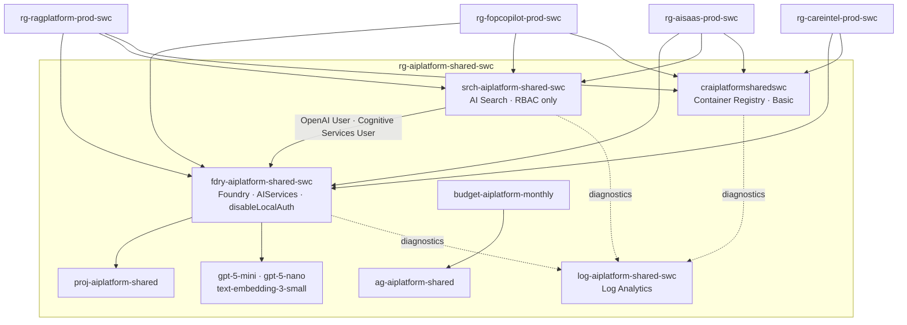

# Azure AI Landing Zone

The shared Azure foundation that four independent AI workloads run on: one resource group holding
Microsoft Foundry model deployments, Azure AI Search, a container registry and the monitoring and
budget around them — designed so that **identity, not the network, is the security boundary**.

## Architecture



## Naming convention

`<type>-<workload>-<purpose>-<region>`, lower case, hyphenated, with `swc` for Sweden Central in
every name. Resource types that forbid hyphens (the container registry) drop them. The three model
deployments are named after the model they deploy, with no suffix, because application code
passes the deployment name and any suffix becomes a defect downstream.

| Prefix | Resource |
|---|---|
| `rg-` | resource group |
| `log-` | Log Analytics workspace |
| `fdry-` / `proj-` | Foundry account / project |
| `srch-` | AI Search service |
| `cr` | container registry |
| `ag-` | action group |
| `budget-` | consumption budget |

## Prerequisites

The template targets an existing resource group and never creates one. Before the first
deployment:

1. The five resource groups exist, created by the bootstrap script in the portfolio's execution
   guide (`rg-aiplatform-shared-swc` and one `rg-<workload>-prod-swc` per workload).
2. The operator's own Entra account holds **data-plane** roles that subscription ownership does
   not confer. Without them, index creation from a laptop fails with an unexplained `403`:

   | Role | Scope | Why |
   |---|---|---|
   | Search Service Contributor | the search service | create indexes, skillsets, indexers and data sources |
   | Search Index Data Contributor | the search service | write documents during local runs |
   | Cognitive Services OpenAI User | the Foundry account | call model deployments from local tests |
   | Foundry User (formerly Azure AI User) | the Foundry account | use the project endpoint from a laptop |

   Assign them after the landing zone exists:

   ```bash
   ME=$(az ad signed-in-user show --query id -o tsv)
   SEARCH=$(az search service list -g rg-aiplatform-shared-swc --query "[0].id" -o tsv)
   FOUNDRY=$(az cognitiveservices account list -g rg-aiplatform-shared-swc --query "[0].id" -o tsv)
   az role assignment create --assignee "$ME" --role "Search Service Contributor"    --scope "$SEARCH"  -o none
   az role assignment create --assignee "$ME" --role "Search Index Data Contributor" --scope "$SEARCH"  -o none
   az role assignment create --assignee "$ME" --role "Cognitive Services OpenAI User" --scope "$FOUNDRY" -o none
   az role assignment create --assignee "$ME" --role "Foundry User"                   --scope "$FOUNDRY" -o none
   ```

3. Azure CLI with the Bicep CLI, Azure Developer CLI, and the alert address exported as
   `ALERT_EMAIL_ADDRESS` in the shell or set in the azd environment. The address is never
   committed.

## Identity and RBAC

| Principal | Role | Scope | Reason |
|---|---|---|---|
| AI Search system-assigned identity | Cognitive Services OpenAI User | Foundry account | the integrated-vectorisation embedding skill calls `text-embedding-3-small` without a key |
| AI Search system-assigned identity | Cognitive Services User | Foundry account | keyless billing of built-in skills (layout, OCR) attached to a skillset |
| GitHub Actions principal of this repository | Contributor, Role Based Access Control Administrator | `rg-aiplatform-shared-swc` | deploy the template and the role assignments it contains; nothing outside the group |
| GitHub Actions principal of each workload | Role Based Access Control Administrator | `rg-aiplatform-shared-swc` | grant their own identities roles on Foundry, Search and the registry |
| Operator | the four data-plane roles above | Search service, Foundry account | run indexing and local tests from a laptop |

## What the workload repositories consume

The deployment outputs are the interface. Each workload passes them as parameters and references
the shared resources as `existing`:

| Output | Consumed for |
|---|---|
| `foundryProjectEndpoint`, `foundryAccountName`, `foundryResourceId` | chat clients, evaluations, role assignments on the account |
| `chatDeploymentName`, `smallChatDeploymentName`, `embeddingDeploymentName` | the only model names application code ever sees |
| `searchEndpoint`, `searchServiceName`, `searchResourceId` | index creation and query clients |
| `searchPrincipalId` | granting the search service `Storage Blob Data Reader` on a workload's own container, in the workload's group |
| `registryLoginServer`, `registryName` | image push from CI and `AcrPull` for container apps |
| `logAnalyticsWorkspaceId`, `actionGroupId` | Application Insights and alerts routed to the shared workspace and receiver |
| `sharedResourceGroupName` | module scoping for cross-group role assignments |

## Deploy

```bash
azd env new prod && azd env set AZURE_RESOURCE_GROUP rg-aiplatform-shared-swc
make whatif
make deploy && make outputs > ../lz-outputs.txt
```

`make validate` builds and lints every template; `make destroy` removes the resources and leaves
the group in place. The targets are thin wrappers, so on a machine without `make` the underlying
`az bicep`, `az deployment group what-if` and `azd` commands in the `Makefile` run as written.

## Federated credentials for GitHub Actions

The deployment identity authenticates with OpenID Connect; no client secret exists. **Three**
federated credentials are required on the app registration, one per subject GitHub sends:

| Subject | Sent by |
|---|---|
| `repo:<org>/azure-ai-landing-zone:ref:refs/heads/main` | pushes to `main` |
| `repo:<org>/azure-ai-landing-zone:pull_request` | pull request validation |
| `repo:<org>/azure-ai-landing-zone:environment:production` | `deploy.yml`, which declares the environment |

A job that declares `environment:` sends the environment subject, not the branch subject. If the
third credential is missing, the first production deployment fails with `AADSTS700213`.

## Cost

Completed in the cost model (`docs/cost.md`) once the estate is deployed and measured.

## Architecture decision records

| ADR | Decision |
|---|---|
| [001](docs/adr/001-shared-platform-and-workload-groups.md) | One shared platform group and one group per workload; what belongs in each |
| 002 | Identity as the security boundary; private networking designed, costed and not deployed |
| 003 | Keyless everywhere: where `disableLocalAuth` applies and what RBAC-only means for Search |
| 004 | Model deployment SKU, and EU data residency as a one-parameter change |
| 005 | Rejection: no Azure Policy assignments at this scale |
| 006 | Rejection: Container Registry stays Basic rather than Premium with private link |

## Scope and simplifications

- No application code and no Python; this repository is infrastructure, queries and decisions.
- The file budget of twenty follows the portfolio convention and excludes `docs/`.
- One Foundry project is shared by all workloads (ADR-001).
- Private endpoints, private DNS zones and virtual networks are designed and costed in ADR-002
  and deliberately not deployed.
