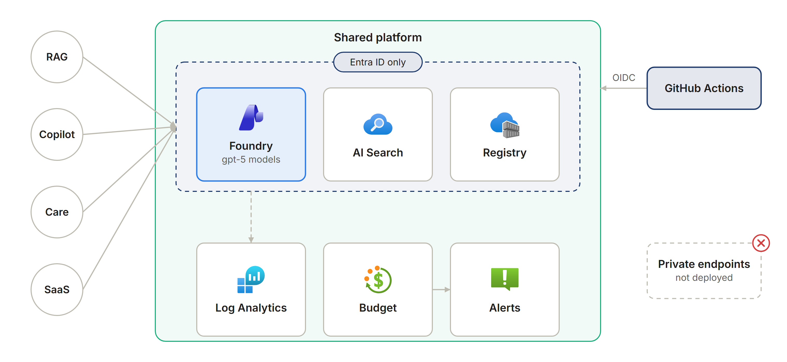
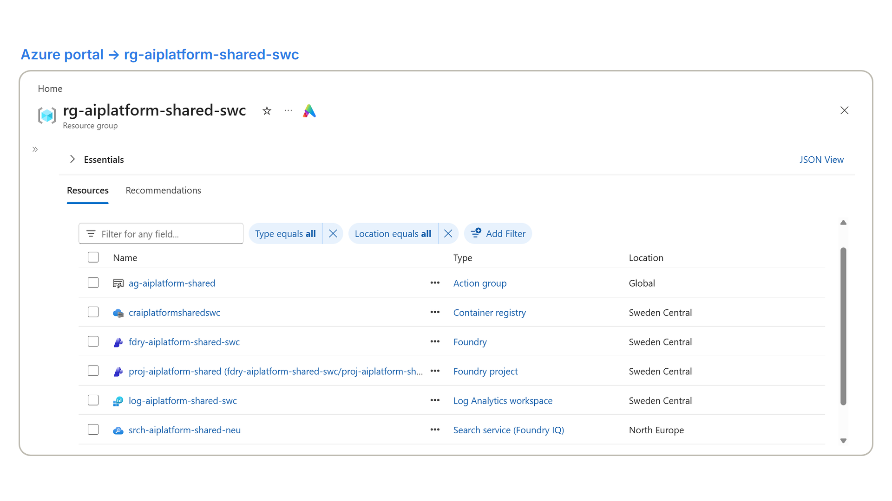
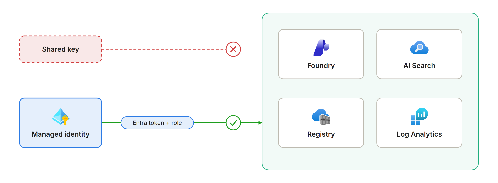
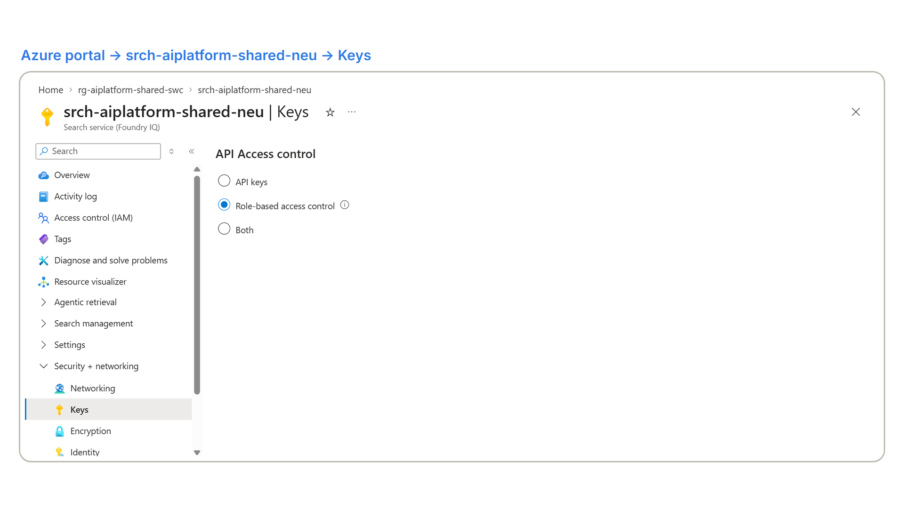
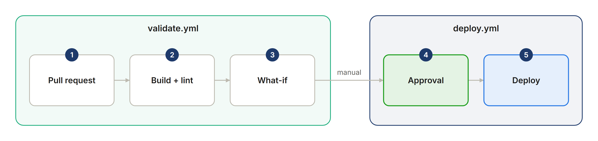
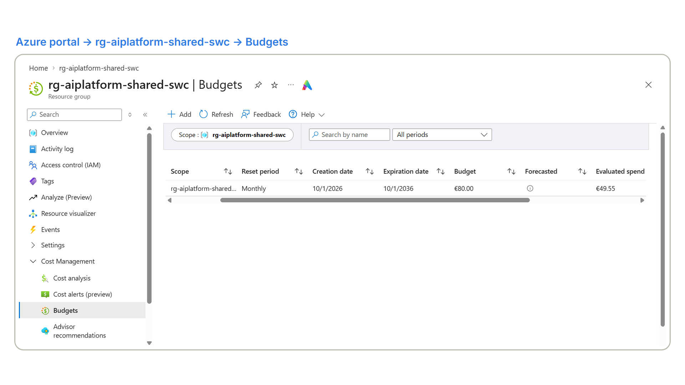

# Azure AI Landing Zone

Built by **Rodrigo Martín Gómez del Moral Herranz** · [LinkedIn](https://www.linkedin.com/in/rodrigo-mart%C3%ADn-g%C3%B3mez-del-moral-herranz) · [Portfolio](https://rodrigogomez.es)

The shared Azure foundation that four independent AI workloads run on: one resource group holding
Microsoft Foundry model deployments, Azure AI Search, a container registry and the monitoring and
budget around them, designed so that **identity, not the network, is the security boundary**.

[](https://github.com/Rodrigo-GomezdelMoral/azure-ai-landing-zone/actions/workflows/validate.yml)
[](https://github.com/Rodrigo-GomezdelMoral/azure-ai-landing-zone/actions/workflows/deploy.yml)

## Architecture





`docs/architecture.md` has the detailed estate, the identity flows and the deployment sequence.

## Naming convention

`<type>-<workload>-<purpose>-<region>`, lower case, hyphenated, with `swc` for Sweden Central in
every name. Resource types that forbid hyphens (the container registry) drop them. The three model
deployments are named after the model they deploy, with no suffix, because application code
passes the deployment name and any suffix becomes a defect downstream.

| Prefix | Resource |
|---|---|
| `rg-` | resource group |
| `log-` | Log Analytics workspace |
| `fdry-` / `proj-` | Foundry account / project |
| `srch-` | AI Search service |
| `cr` | container registry |
| `ag-` | action group |
| `budget-` | consumption budget |

## Prerequisites

The template targets an existing resource group and never creates one. Before the first
deployment:

1. **The five resource groups exist**, created once by the bootstrap script in the portfolio's
   execution guide: `rg-aiplatform-shared-swc` and one `rg-<workload>-prod-swc` per workload. The
   CI principal of this repository holds Contributor and Role Based Access Control Administrator
   on the shared group only.
2. **The operator's own Entra account holds data-plane roles** that subscription ownership does
   not confer. Without them, index creation from a laptop fails with an unexplained `403`:

   | Role | Scope | Why |
   |---|---|---|
   | Search Service Contributor | the search service | create indexes, skillsets, indexers and data sources |
   | Search Index Data Contributor | the search service | write documents during local runs |
   | Cognitive Services OpenAI User | the Foundry account | call model deployments from local tests |
   | Foundry User (formerly Azure AI User) | the Foundry account | use the project endpoint from a laptop |

   Assign them after the landing zone exists; propagation can take a few minutes:

   ```bash
   ME=$(az ad signed-in-user show --query id -o tsv)
   SEARCH=$(az search service list -g rg-aiplatform-shared-swc --query "[0].id" -o tsv)
   FOUNDRY=$(az cognitiveservices account list -g rg-aiplatform-shared-swc --query "[0].id" -o tsv)
   az role assignment create --assignee "$ME" --role "Search Service Contributor"    --scope "$SEARCH"  -o none
   az role assignment create --assignee "$ME" --role "Search Index Data Contributor" --scope "$SEARCH"  -o none
   az role assignment create --assignee "$ME" --role "Cognitive Services OpenAI User" --scope "$FOUNDRY" -o none
   az role assignment create --assignee "$ME" --role "Foundry User"                   --scope "$FOUNDRY" -o none
   ```

   Each workload adds `Cosmos DB Built-in Data Contributor` on its own account as a SQL role
   assignment, which is a separate data plane and is not inherited either.
3. **Tooling and one deploy-time value.** Azure CLI with the Bicep CLI, Azure Developer CLI, and
   the notification address exported as `ALERT_EMAIL_ADDRESS` or set in the azd environment. The
   address is never committed; `infra/main.bicepparam` reads it from the environment.

## Identity and RBAC



| Principal | Role | Scope | Reason |
|---|---|---|---|
| AI Search system-assigned identity | Cognitive Services OpenAI User | Foundry account | the integrated-vectorisation embedding skill calls `text-embedding-3-small` without a key |
| AI Search system-assigned identity | Cognitive Services User | Foundry account | keyless billing of built-in skills (layout, OCR) attached to a skillset |
| GitHub Actions principal of this repository | Contributor, Role Based Access Control Administrator | `rg-aiplatform-shared-swc` | deploy the template, including the two role assignments it contains; nothing outside the group |
| GitHub Actions principal of each workload | Role Based Access Control Administrator | `rg-aiplatform-shared-swc` | grant their own identities roles on Foundry, Search and the registry |
| Operator | the four data-plane roles above | Search service, Foundry account | run indexing and local tests from a laptop |

Every service accepts Entra tokens only: `disableLocalAuth` on Foundry and on the workspace,
RBAC-only authentication on Search, no admin user on the registry. There is no Key Vault because
there is no secret to keep (ADR-003). `docs/security.md` has the full posture.



## What the workload repositories consume

The deployment outputs are the interface. Each workload passes them as parameters, references
the shared resources as `existing`, and scopes its cross-group role assignments to
`sharedResourceGroupName`:

| Output | Consumed for |
|---|---|
| `foundryProjectEndpoint`, `foundryAccountName`, `foundryResourceId`, `foundryProjectName`, `foundryEndpoint` | chat clients, evaluations, role assignments on the account |
| `chatDeploymentName`, `smallChatDeploymentName`, `embeddingDeploymentName` | the only model names application code ever sees |
| `searchEndpoint`, `searchServiceName`, `searchResourceId` | index creation and query clients |
| `searchPrincipalId` | granting the search service `Storage Blob Data Reader` on a workload's own container, in the workload's group |
| `registryLoginServer`, `registryName` | image push from CI and `AcrPull` for container apps |
| `logAnalyticsWorkspaceId`, `actionGroupId` | workspace-based Application Insights and alerts routed to the shared receiver |
| `sharedResourceGroupName` | module scoping for cross-group role assignments |

## Deploy

```bash
azd env new prod && azd env set AZURE_RESOURCE_GROUP rg-aiplatform-shared-swc && azd env set ALERT_EMAIL_ADDRESS <address>
make whatif
make deploy && make outputs > ../lz-outputs.txt
```

`make validate` builds and lints every template with the rule levels in `bicepconfig.json`;
`make destroy` removes the resources and leaves the group in place. The targets are thin
wrappers, so on a machine without `make` the underlying `az bicep`, `az deployment group what-if`
and `azd` commands in the `Makefile` run as written. Keep `lz-outputs.txt` outside git: it
contains resource ids.

In GitHub Actions, `validate.yml` runs on every pull request (build, lint, OIDC login,
`what-if` against the shared group) and `deploy.yml` runs only on `workflow_dispatch` through the
`production` environment. Both pass `--only-show-errors` on every `az` call, never print the
`AZURE_*` identifiers, and the deploy step runs with `--output none` so deployment outputs stay
out of public logs.



### Verify after deploying

```bash
az resource list -g rg-aiplatform-shared-swc --query "[].{name:name, type:type}" -o table
az cognitiveservices account show -n fdry-aiplatform-shared-swc -g rg-aiplatform-shared-swc --query "{localAuth:properties.disableLocalAuth}" -o table
az search service list -g rg-aiplatform-shared-swc --query "[0].{name:name, localAuth:disableLocalAuth, authOptions:authOptions}" -o json
az resource list --tag repo=azure-ai-landing-zone --query "[].name" -o table
```

The second shows `true`, the third shows `true` with `authOptions` null, and the fourth is the
tag that makes cost attribution per repository possible. On an estate that is already deployed,
`make whatif` reports `Modify` for read-only properties the services return and the template
does not set (current capacity, deployment state, disabled diagnostic categories, the budget's
`utcNow` start date) and for the registry's log destination type, which the service does not
return although the logs reach their resource-specific tables; it never reports a `Create` or a
`Delete`.

## Federated credentials for GitHub Actions

The deployment identity authenticates with OpenID Connect; no client secret exists. **Three**
federated credentials are required on the app registration, one per subject GitHub sends:

| Subject | Sent by |
|---|---|
| `repo:<owner>@<owner id>/azure-ai-landing-zone@<repository id>:ref:refs/heads/main` | pushes to `main` |
| `repo:<owner>@<owner id>/azure-ai-landing-zone@<repository id>:pull_request` | pull request validation |
| `repo:<owner>@<owner id>/azure-ai-landing-zone@<repository id>:environment:production` | `deploy.yml`, which declares the environment |

The subjects carry the owner's and the repository's numeric ids: repositories created after
15 July 2026 send GitHub's *immutable subject*, which survives a rename or a transfer, and
`gh api repos/<owner>/<repo>/actions/oidc/customization/sub` prints the exact prefix. A credential
written in the older name-only form, `repo:<owner>/azure-ai-landing-zone:pull_request`, no longer
matches and the login fails with `AADSTS700213` *No matching federated identity record found*.
A job that declares `environment:` sends the environment subject, not the branch subject, so the
third credential is not optional. No workflow in this repository runs on push to `main`, so the
`ref:refs/heads/main` credential is declared for completeness and exercised by nothing today.

## Cost

Estimated from list prices retrieved on 2026-10-14 (`docs/cost.md` has the meters and the
method): the shared group as deployed costs about **2.3 a day, 70 to 77 a month**, more than
ninety percent of it the Basic search service; model usage bills tokens only, about 3.6 per
thousand regulatory questions. The network-isolated posture — private endpoints, private DNS
zones, a Premium registry and a jump host — would add about **163 a month**, or 257 with a VPN
gateway (ADR-002). Measured over the eleven full days from 15 to 25 October 2026: 2.28 on a day
without model usage, as estimated, and 39.76 in total with the model and tool usage billed to the
shared Foundry account; the document has the breakdown and the query.



## Well-Architected design

How the design maps to the five pillars of the Azure Well-Architected Framework, and the trade-off accepted in each.

| Pillar | Applied | Trade-off accepted |
|---|---|---|
| Reliability | One shared group whose deployment outputs are a stable interface for four workloads; redeploys are idempotent, and `what-if` on the deployed estate never reports a create or a delete | One region and one instance of each service: redundancy would multiply the cost of an estate that serves demonstrations |
| Security | Identity is the boundary: Entra tokens only (`disableLocalAuth`, RBAC-only Search, no registry admin user), no secret to keep, OIDC with no client secret | Private networking designed and costed at about 163 a month, not deployed (ADR-002) |
| Cost Optimization | About 70 to 77 a month, more than ninety percent of it the Basic search service; models bill tokens only; a monthly budget; the `repo` tag attributes cost per repository | A Basic registry rather than Premium with private link (ADR-006) |
| Operational Excellence | Bicep built and linted on every pull request, `what-if` against the shared group, a manual deployment through the `production` environment, one naming convention | No Azure Policy assignments at this scale (ADR-005) |
| Performance Efficiency | Three shared model deployments, a chat model, a small chat model and an embedding model, so each workload calls the smallest one that does the job | Shared deployments: one workload's burst competes with the others for the same capacity |

## Architecture decision records

| ADR | Decision |
|---|---|
| [001](docs/adr/001-shared-platform-and-workload-groups.md) | One shared platform group and one group per workload; what belongs in each |
| [002](docs/adr/002-identity-boundary-private-networking-not-deployed.md) | Identity as the security boundary; private networking designed, costed and not deployed |
| [003](docs/adr/003-keyless-everywhere.md) | Keyless everywhere: where `disableLocalAuth` applies and what RBAC-only means for Search |
| [004](docs/adr/004-model-deployment-sku-and-data-residency.md) | Model deployment SKU, and EU data residency as a one-parameter change |
| [005](docs/adr/005-no-azure-policy-assignments.md) | Rejection: no Azure Policy assignments at this scale |
| [006](docs/adr/006-container-registry-basic.md) | Rejection: Container Registry stays Basic rather than Premium with private link |

## Author

**Rodrigo Martín Gómez del Moral Herranz** · [LinkedIn](https://www.linkedin.com/in/rodrigo-mart%C3%ADn-g%C3%B3mez-del-moral-herranz) · [Portfolio](https://rodrigogomez.es)
