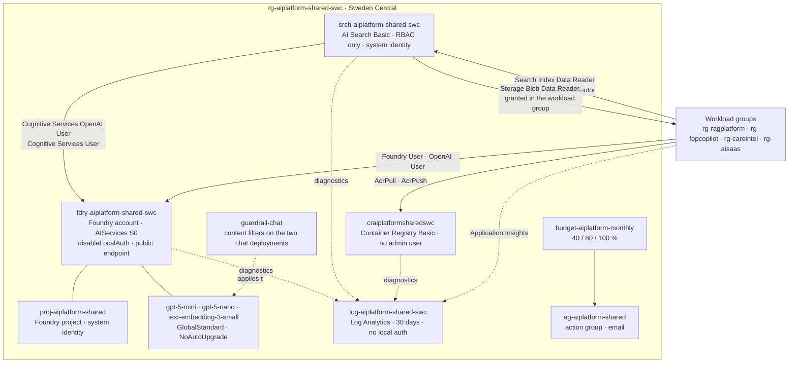
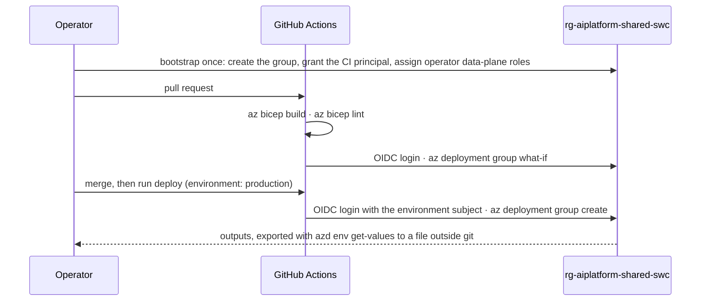

# Architecture

The landing zone is one resource group, `rg-aiplatform-shared-swc`, holding the resources that
are expensive, quota-bound or consumed by more than one workload. Four workload groups consume
it through the deployment outputs; nothing in the shared group knows a workload exists.

## Estate

## The interface: deployment outputs

A workload never discovers shared resources by name. It receives the seventeen outputs of
`infra/main.bicep` as parameters, declares the shared resources as `existing`, and scopes its
cross-group role assignments to `sharedResourceGroupName`.

| Output | Type | Used for |
|---|---|---|
| `foundryEndpoint` | URL | Azure OpenAI and Foundry Tools calls from application code |
| `foundryProjectEndpoint` | URL | Foundry SDK clients, evaluations and traces |
| `foundryAccountName`, `foundryResourceId`, `foundryProjectName` | names and id | `existing` references and role assignment scopes |
| `chatDeploymentName`, `smallChatDeploymentName`, `embeddingDeploymentName` | names | the only model identifiers application code holds |
| `searchEndpoint`, `searchServiceName`, `searchResourceId` | URL, name, id | search clients and Search data-plane roles |
| `searchPrincipalId` | object id | `Storage Blob Data Reader` for the indexer on each workload's own container |
| `registryLoginServer`, `registryName` | name | image references and `AcrPull` |
| `logAnalyticsWorkspaceId`, `actionGroupId` | ids | workspace-based Application Insights and alert routing |
| `sharedResourceGroupName` | name | the `scope` of modules that grant roles on shared resources |

## Identity flows

Every arrow in the diagram is a role assignment on a managed identity or an operator account;
no arrow is a key. The three flows a reviewer should be able to trace:

1. **Indexing.** A workload's indexer runs inside the shared search service. The search identity
   reads blobs with `Storage Blob Data Reader` (granted in the workload group), calls the
   embedding deployment with `Cognitive Services OpenAI User`, and bills built-in skills with
   `Cognitive Services User` (both granted here, in `infra/modules/search.bicep`).
2. **Inference.** A workload's container identity calls the project endpoint with `Foundry User`
   and the account endpoint with `Cognitive Services OpenAI User`, granted by the workload's own
   template through a module scoped to this group.
3. **Deployment.** The GitHub Actions principal of this repository holds Contributor and Role
   Based Access Control Administrator on this group only, and authenticates with OpenID Connect.

## Deployment flow

Locally the same flow is `make whatif`, `make deploy` and `make outputs`, which wrap
`az deployment group what-if`, `azd provision` and `azd env get-values`.

## What is deliberately absent

| Not deployed | Where the decision is recorded |
|---|---|
| Virtual network, private endpoints, private DNS zones | ADR-002 |
| Key Vault | ADR-003: there is no secret to store |
| Azure Policy assignments | ADR-005 |
| Container Registry Premium and its private link | ADR-006 |
| A second Foundry project per workload | ADR-001 |
| Workbooks or dashboards | `monitoring/queries.kql` holds the five queries as portable text |
